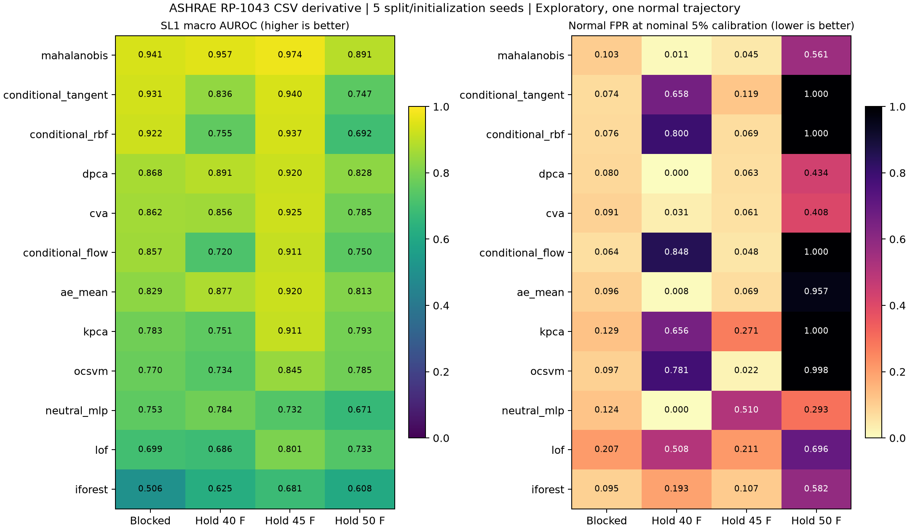

# RP-1043: предварительные результаты на CSV-копии

Дата: 4 ноября 2026. Основной обзор и математическая постановка: [исследование](../../docs/research/ashrae_rp1043_research_2026-11-04.md).

**Это разведочный эксперимент, не подтверждение SOTA.** Одна нормальная траектория, искусственные временные блоки и повторяющиеся округлённые timestamps ограничивают выводы. Пять seeds показывают чувствительность к разбиению/инициализации, а не пять независимых испытаний.

Обучены 12 методов × 4 протокола × 5 seeds = 240 моделей. Оценены семь типов неисправностей на SL1–SL4. Метки неисправностей не использованы для обучения, порога или подбора гиперпараметров. Значения ниже — средние по семи отказам и пяти seeds.

## Слабые неисправности SL1: разделение по блокам

Порог задан по нормальной калибровке с номинальным оконным уровнем 5%. Фактический тестовый FPR показан отдельно; методы работают при разных достигнутых FPR. Поэтому recall нельзя сравнивать как recall при одинаковом фактическом FPR. ± означает стандартное отклонение по seeds, не доверительный интервал.

| Метод | AUROC ± SD | Recall, % | FPR нормы, % |
|---|---:|---:|---:|
| mahalanobis | 0.9413 ± 0.0379 | 65.90 | 10.31 |
| conditional_tangent | 0.9311 ± 0.0393 | 60.72 | 7.39 |
| conditional_rbf | 0.9224 ± 0.0471 | 59.53 | 7.55 |
| dpca | 0.8677 ± 0.0270 | 55.63 | 8.03 |
| cva | 0.8617 ± 0.0565 | 38.27 | 9.14 |
| conditional_flow | 0.8572 ± 0.0311 | 52.57 | 6.41 |
| ae_mean | 0.8288 ± 0.0671 | 48.62 | 9.62 |
| kpca | 0.7834 ± 0.0486 | 49.73 | 12.88 |
| ocsvm | 0.7697 ± 0.0404 | 47.59 | 9.65 |
| neutral_mlp | 0.7528 ± 0.0763 | 43.06 | 12.40 |
| lof | 0.6987 ± 0.0690 | 48.22 | 20.75 |
| iforest | 0.5055 ± 0.0635 | 9.63 | 9.47 |

## Смена уставки: AUROC / FPR нормы

Удерживается целая температурная полоса 40, 45 или 50 °F. Калибровка остаётся в исходном домене. 45 °F — промежуточная уставка, 40/50 °F — крайние; это не проверка всех 27 исходных режимов и не перенос между установками.

| Метод | Hold 40 °F | Hold 45 °F | Hold 50 °F |
|---|---:|---:|---:|
| mahalanobis | 0.957 / 1.1% | 0.974 / 4.5% | 0.891 / 56.1% |
| conditional_tangent | 0.836 / 65.8% | 0.940 / 11.9% | 0.747 / 100.0% |
| conditional_rbf | 0.755 / 80.0% | 0.937 / 6.9% | 0.692 / 100.0% |
| dpca | 0.891 / 0.0% | 0.920 / 6.3% | 0.828 / 43.4% |
| cva | 0.856 / 3.1% | 0.925 / 6.1% | 0.785 / 40.8% |
| conditional_flow | 0.720 / 84.8% | 0.911 / 4.8% | 0.750 / 100.0% |
| ae_mean | 0.877 / 0.8% | 0.920 / 6.9% | 0.813 / 95.7% |
| kpca | 0.751 / 65.6% | 0.911 / 27.1% | 0.793 / 100.0% |
| ocsvm | 0.734 / 78.1% | 0.845 / 2.2% | 0.785 / 99.8% |
| neutral_mlp | 0.784 / 0.0% | 0.732 / 51.0% | 0.671 / 29.3% |
| lof | 0.686 / 50.8% | 0.801 / 21.1% | 0.733 / 69.6% |
| iforest | 0.625 / 19.3% | 0.681 / 10.7% | 0.608 / 58.2% |



## Что действительно следует из эксперимента

1. Mahalanobis с усадкой — сильнейший из проверенных ориентиров по среднему AUROC во всех четырёх протоколах. На blocked SL1 AUROC = 0.9413, однако FPR = 10.31% при номинале 5%. Лидерство по AUROC не означает допустимые эксплуатационные тревоги.
2. Проекция касательного пространства улучшает conditional RBF по AUROC в этих протоколах, но не обгоняет Mahalanobis. На Hold 50 °F обе условные версии имеют FPR = 100%.
3. Компактный conditional flow и NeuTraL MLP не показали универсального преимущества. Это конкретные небольшие реализации с фиксированными настройками, а не опровержение соответствующих семейств или воспроизведение статей FDSD/MTGFlow.
4. Hold 50 °F труден для всех: даже Mahalanobis имеет FPR = 56.07%. Автоматически считать выход за обучающий режим неисправностью нельзя.
5. При бюджете 1% во всех LOTO-разбиениях недостаточно даже калибровочных окон для конечного рангового порога; возвращён +∞ и recall равен нулю. При 5% конечный порог всё равно не получает гарантии из-за зависимости/сдвига распределения.

## Mahalanobis: отдельные неисправности SL1

| Неисправность | AUROC | Recall при номинальном пороге 5%, % |
|---|---:|---:|
| cf | 0.9954 | 100.00 |
| eo | 0.9456 | 59.91 |
| fwc | 0.9848 | 73.83 |
| fwe | 1.0000 | 100.00 |
| nc | 0.9813 | 60.45 |
| rl | 0.7968 | 23.06 |
| ro | 0.8849 | 44.03 |

Обозначения: cf — загрязнение конденсатора; eo — избыток масла; fwc/fwe — уменьшение расхода воды конденсатора/испарителя; nc — неконденсируемый газ; rl — утечка хладагента; ro — избыток хладагента.

## Воспроизведение

```powershell
uv pip install --python .venv/Scripts/python.exe -r requirements-ashrae.txt
uv pip install --python .venv/Scripts/python.exe -r requirements-neural.txt
.venv/Scripts/python.exe scripts/prepare_ashrae_public.py
.venv/Scripts/python.exe scripts/run_ashrae_benchmark.py
.venv/Scripts/python.exe scripts/summarize_ashrae_benchmark.py
```

[Паспорт источника](data_manifest.json), [аудит CSV](data_audit.csv), [замороженный протокол](experiment_manifest.json), [все результаты](per_fault.csv), [агрегация](summary.csv), [калибровка и FPR](normal_metrics.csv), [время и потери обучения](training.csv).

balanced_ap в таблицах вычислен при искусственном априорном классовом балансе 50/50 для каждой пары normal/fault. Он не оценивает precision при реальной редкости отказов. Времена в training.csv включают fit и нормальные оценки, но не полный faulty inference.
