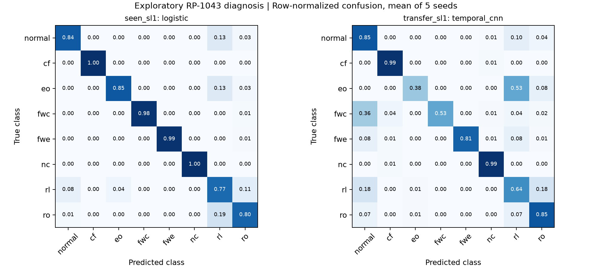

# RP-1043: supervised diagnosis, отдельный трек

Дата: 4 ноября 2026. [Математика и общий протокол](../../../docs/research/ashrae_rp1043_research_2026-11-04.md).

Обучены **6 методов × 2 сценария × 4 протокола × 5 seeds = 240 моделей**. Это восемь классов (normal + семь неисправностей). Fault labels разрешены в обучении; результаты нельзя напрямую ранжировать вместе с normal-only novelty detection.

**Разведочная проверка, без заявления SOTA.** Данные — авторская CSV-копия; один нормальный файл и по одному файлу на fault/severity. В seen SL1 разные блоки одного файла попадают в обучение и тест: эффект неисправности может быть смешан с особенностями конкретной записи. Независимые повторные эксперименты отсутствуют. Seeds не заменяют их.

## Два сценария

- `seen_sl1`: обучение на fit-блоках SL1; тест на других блоках SL1.
- `transfer_sl1`: обучение только на SL2–SL4 для каждой неисправности; тест на SL1. Классы неисправностей известны, их слабая выраженность в обучении отсутствует. Одна normal trajectory разделена без дублирования между severities.

Общие allowlist, ширина окна, embargo и протоколы совпадают с novelty треком. Классические модели получают mean+std (52 признака), CNN — полное окно 12×26. Все scalers обучены только на разрешённых supervised fit-данных; веса классов определяются только по обучению. Параметры фиксированы без test-based подбора.

## Временные блоки, SL1

± — SD по пяти split/initialization seeds, не доверительный интервал. FPR означает долю normal окон, классифицированных как любая неисправность; порог в 5% из novelty трека здесь не используется.

| Метод | Seen SL1: macro-F1 ± SD | FPR, % | SL2–SL4 → SL1: macro-F1 ± SD | FPR, % |
|---|---:|---:|---:|---:|
| logistic | 0.9046 ± 0.0353 | 16.07 | 0.5564 ± 0.0688 | 13.66 |
| rbf_svm | 0.8538 ± 0.0365 | 23.09 | 0.6602 ± 0.0482 | 24.00 |
| random_forest | 0.7913 ± 0.0403 | 35.83 | 0.5998 ± 0.0620 | 55.24 |
| extra_trees | 0.7988 ± 0.0641 | 31.62 | 0.7156 ± 0.0519 | 77.78 |
| hist_gradient_boosting | 0.8019 ± 0.0451 | 30.59 | 0.7349 ± 0.0479 | 33.29 |
| temporal_cnn | 0.8991 ± 0.0245 | 17.10 | 0.7508 ± 0.0535 | 15.17 |

## Удержанная температурная полоса

В ячейке macro-F1 / FPR нормальных окон. Классификатор обучен только на source bands; target labels в обучение не попадают.

### seen_sl1

| Метод | Hold 40 °F | Hold 45 °F | Hold 50 °F |
|---|---:|---:|---:|
| logistic | 0.862 / 13.6% | 0.928 / 10.4% | 0.863 / 22.7% |
| rbf_svm | 0.741 / 10.3% | 0.919 / 11.2% | 0.588 / 89.1% |
| random_forest | 0.754 / 30.3% | 0.824 / 41.5% | 0.689 / 88.3% |
| extra_trees | 0.755 / 35.3% | 0.782 / 70.6% | 0.689 / 89.5% |
| hist_gradient_boosting | 0.789 / 27.6% | 0.872 / 26.1% | 0.735 / 61.5% |
| temporal_cnn | 0.672 / 4.1% | 0.854 / 64.3% | 0.681 / 9.2% |

### transfer_sl1

| Метод | Hold 40 °F | Hold 45 °F | Hold 50 °F |
|---|---:|---:|---:|
| logistic | 0.589 / 11.4% | 0.549 / 4.1% | 0.528 / 24.3% |
| rbf_svm | 0.539 / 16.4% | 0.672 / 10.4% | 0.380 / 87.5% |
| random_forest | 0.607 / 66.0% | 0.589 / 78.0% | 0.489 / 96.9% |
| extra_trees | 0.644 / 91.4% | 0.671 / 99.6% | 0.623 / 99.7% |
| hist_gradient_boosting | 0.717 / 41.6% | 0.768 / 41.8% | 0.682 / 83.0% |
| temporal_cnn | 0.500 / 19.2% | 0.830 / 20.6% | 0.547 / 26.2% |

## Выводы

На blocked seen SL1 лучший средний macro-F1 у logistic regression (0.9046); temporal CNN близка (0.8991). Сложность модели не гарантирует улучшение.

При SL2–SL4 → SL1 на blocked лучшая из проверенных — temporal CNN (0.7508), затем histogram gradient boosting (0.7349). Это предварительный результат; при переносе температурных условий устойчивого универсального лидера нет.

Ошибки нормы остаются существенными даже при высоком macro-F1: fault diagnosis по восьми классам и надёжная выдача тревоги требуют раздельной оценки. Точные значения, включая все normal FPR, приведены в таблицах выше.



## Воспроизведение

```powershell
.venv/Scripts/python.exe scripts/run_ashrae_supervised.py
.venv/Scripts/python.exe scripts/summarize_ashrae_supervised.py
```

[Manifest](manifest.json), [split blocks](split_blocks.json), [per-seed metrics](per_seed.csv), [per-class recall и confusion rows](per_class.csv), [summary](summary.csv).
