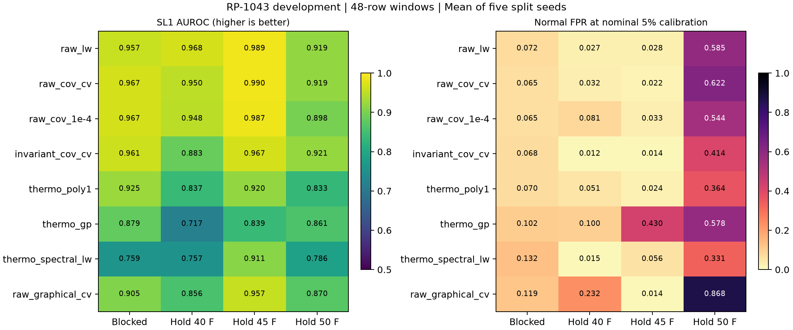
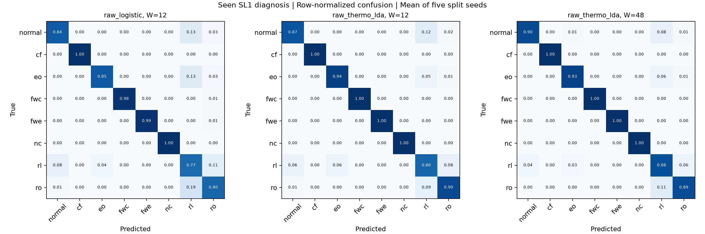

# RP-1043: второй раунд, результаты перспективных направлений

Дата: 4 ноября 2026. [Литература, математика и анализ ограничений](../../docs/research/ashrae_promising_directions_2026-11-04.md).

**2240 завершённых обучений:** 680 normal-only, 960 supervised, 360 covariance follow-up и 240 scaling audit (включая повторные baseline). Это development на уже просмотренной авторской CSV-копии, не независимое подтверждение SOTA. Пять seeds — split/initialization variability, не независимые чиллеры.

## Что улучшилось

- Normal-only: при W48 covariance shrinkage с выбором по normal reference даёт blocked SL1 AUROC 0.9669, recall 66.80%, FPR 6.51%. Исходный W12 Ledoit–Wolf: AUROC 0.9413, FPR 10.31%. Порог в обоих случаях имеет номинальный calibration budget 5%, но достигнутые FPR различаются.
- Diagnosis seen SL1: при том же W12 raw+thermo LDA поднимает macro-F1 с 0.9046 до 0.9368 и уменьшает normal FPR с 16.07% до 13.33%. W48 LDA: macro-F1 0.9499, FPR 9.91%.
- Положительный эффект длинного окна сохраняется в анализе одинаковых calibration/test endpoints. Это контролирует изменение test support, но fit support и представление окна остаются разными.

## Что не решено

Hold 50 °F по-прежнему вызывает много ложных тревог. Seen-fault выигрыш LDA не переносится на SL2–SL4 → SL1. EOS, короткие спектральные признаки, GP, MEWMA/scan и простые severity signatures не дали универсального улучшения. Ниже сохранены все варианты.

## Normal-only: blocked SL1

В ячейке AUROC / normal FPR. Порог определяется только нормальной калибровкой; recall и per-fault показатели находятся в CSV. Сравнение W12/W48 по этим строкам допускает разные test endpoints; соответствующий контроль приведён далее.

| Метод | W12: AUROC / FPR | W48: AUROC / FPR |
|---|---:|---:|
| raw_cov_1e-4 | 0.9398 / 6.36% | 0.9675 / 6.51% |
| raw_cov_cv | 0.9435 / 6.53% | 0.9669 / 6.51% |
| invariant_cov_cv | 0.9418 / 6.55% | 0.9610 / 6.76% |
| raw_lw | 0.9413 / 10.31% | 0.9571 / 7.25% |
| raw_oas | 0.9401 / 10.48% | 0.9540 / 8.71% |
| invariant_lw | 0.9226 / 6.86% | 0.9417 / 7.46% |
| raw_mewma | 0.9159 / 8.53% | 0.9263 / 6.93% |
| thermo_poly1 | 0.8873 / 7.27% | 0.9247 / 7.01% |
| thermo_poly2 | 0.8861 / 7.60% | 0.9199 / 8.25% |
| thermo_lw | 0.8705 / 6.71% | 0.9154 / 6.00% |
| thermo_oas | 0.8712 / 6.71% | 0.9137 / 5.75% |
| invariant_graphical_cv | 0.8910 / 7.59% | 0.9117 / 10.17% |
| raw_graphical_cv | 0.8965 / 10.96% | 0.9052 / 11.87% |
| raw_gp | 0.8785 / 9.79% | 0.9041 / 6.40% |
| thermo_unit_oas | 0.8687 / 7.04% | 0.9026 / 6.51% |
| thermo_unit_lw | 0.8658 / 7.04% | 0.9024 / 6.51% |
| thermo_eos_lw | 0.8592 / 8.53% | 0.9003 / 6.23% |
| thermo_scan | 0.8626 / 7.22% | 0.8908 / 6.50% |
| thermo_eos_unit_lw | 0.8551 / 8.69% | 0.8870 / 6.49% |
| thermo_pca_spe | 0.8255 / 6.31% | 0.8827 / 6.01% |
| thermo_unit_cv | 0.8748 / 7.39% | 0.8825 / 6.51% |
| thermo_mewma | 0.8587 / 6.15% | 0.8817 / 6.25% |
| raw_pca_spe | 0.8965 / 11.55% | 0.8794 / 12.12% |
| thermo_gp | 0.8271 / 4.96% | 0.8789 / 10.23% |
| thermo_cov_cv | 0.8748 / 7.39% | 0.8787 / 6.51% |
| thermo_graphical_cv | 0.8454 / 6.86% | 0.8762 / 6.25% |
| raw_spectral_lw | 0.7872 / 9.87% | 0.7674 / 11.65% |
| thermo_spectral_lw | 0.7667 / 9.96% | 0.7589 / 13.17% |

В отдельном unit-scaling audit убран общий floor 0.05 для разномерных физических признаков. thermo_unit_* использует стандартное отклонение каждой неконстантной координаты. Это восстановило инвариантность к смене единиц мощности (проверена тестом), но не улучшило основной результат: W48 thermo_unit_lw AUROC 0.9024 против thermo_lw 0.9154 и raw covariance CV 0.9669. Все четыре новые абляции показаны выше.

`cov_cv` означает выбор shrinkage по отложенной норме; `graphical_cv` — такой же выбор L1 precision; `raw_cov_1e-4` — фиксированная абляция. Суффикс CV не означает настройку на fault test. `thermo` использует fixed physical map, `eos` дополнительно предполагает R134a/Fahrenheit/psig.

## Перенос режима: отдельные новые кандидаты, W48 SL1

В ячейке AUROC / recall / normal FPR. Низкий FPR не следует читать без recall.

| Метод | Hold 40 °F | Hold 45 °F | Hold 50 °F |
|---|---:|---:|---:|
| raw_lw | 0.968 / 63.3% / 2.7% | 0.989 / 74.3% / 2.8% | 0.919 / 97.6% / 58.5% |
| raw_cov_cv | 0.950 / 63.9% / 3.2% | 0.990 / 72.8% / 2.2% | 0.919 / 95.7% / 62.2% |
| invariant_cov_cv | 0.883 / 46.9% / 1.2% | 0.967 / 58.0% / 1.4% | 0.921 / 92.0% / 41.4% |
| thermo_poly1 | 0.837 / 53.3% / 5.1% | 0.920 / 53.2% / 2.4% | 0.833 / 76.6% / 36.4% |
| thermo_gp | 0.717 / 45.8% / 10.0% | 0.839 / 70.0% / 43.0% | 0.861 / 85.0% / 57.8% |
| thermo_spectral_lw | 0.757 / 24.5% / 1.5% | 0.911 / 46.5% / 5.6% | 0.786 / 72.1% / 33.1% |

## Проверка одинаковых концов окон

Calibration endpoints и normal/fault test endpoints совпадают между W12/W48. Threshold пересчитан отдельно для каждой модели на общей calibration population, без использования test для выбора порога. Таблица — blocked SL1.

| Метод | W12 AUROC / FPR | W48 AUROC / FPR |
|---|---:|---:|
| invariant_cov_cv | 0.9493 / 4.74% | 0.9610 / 6.76% |
| invariant_lw | 0.9323 / 6.49% | 0.9417 / 7.46% |
| raw_cov_cv | 0.9502 / 5.49% | 0.9669 / 6.51% |
| raw_graphical_cv | 0.9038 / 10.17% | 0.9052 / 11.87% |
| raw_lw | 0.9476 / 10.13% | 0.9571 / 7.25% |

[Все matched результаты](matched_windows_summary.csv). Это post-hoc development analysis; он не создаёт нового независимого теста.



## Supervised: два разных сценария

Значения — macro-F1 / normal FPR для blocked. У ordinary classifiers нет 5% rejection threshold. Ray/subspace classifiers используют дополнительную normal reference/calibration для gate. Это указано в manifest.

| Метод | W12 seen SL1 | W48 seen SL1 | W12 SL2–4 → SL1 | W48 SL2–4 → SL1 |
|---|---:|---:|---:|---:|
| raw_logistic | 0.9046 / 16.07% | 0.8951 / 20.43% | 0.5580 / 13.83% | 0.5582 / 15.98% |
| raw_thermo_lda | 0.9368 / 13.33% | 0.9499 / 9.91% | 0.4017 / 4.97% | 0.4024 / 4.22% |
| raw_thermo_logistic | 0.9175 / 17.17% | 0.8927 / 20.31% | 0.6078 / 11.85% | 0.5957 / 13.43% |
| raw_thermo_svm | 0.8875 / 17.39% | 0.8583 / 24.27% | 0.6449 / 19.30% | 0.6266 / 19.53% |
| ray_conditional_thermo | 0.5668 / 7.64% | 0.6098 / 3.25% | 0.4545 / 7.29% | 0.4716 / 3.50% |
| ray_invariant | 0.6091 / 10.73% | 0.6273 / 10.40% | 0.4939 / 10.89% | 0.5282 / 8.64% |
| ray_thermo | 0.6102 / 11.39% | 0.6627 / 9.59% | 0.4613 / 8.86% | 0.5373 / 6.74% |
| subspace_thermo | 0.5068 / 7.69% | 0.5807 / 6.75% | 0.4407 / 8.23% | 0.5386 / 5.50% |
| thermo_eos_logistic | 0.9143 / 19.35% | 0.9249 / 12.58% | 0.5715 / 12.03% | 0.5576 / 13.11% |
| thermo_lda | 0.9093 / 18.78% | 0.9409 / 11.39% | 0.3535 / 6.12% | 0.3592 / 4.46% |
| thermo_logistic | 0.9077 / 20.10% | 0.8813 / 25.88% | 0.5946 / 14.31% | 0.5493 / 19.21% |
| thermo_svm | 0.8878 / 15.62% | 0.8572 / 31.46% | 0.6106 / 18.97% | 0.5893 / 27.34% |

[Все supervised режимы](supervised/summary.csv), [per-class recall и confusion rows](supervised/per_class.csv). Предыдущая temporal CNN (W12, blocked transfer macro-F1 0.7509) сильнее новых кандидатов в переносе severity. Победу LDA в seen SL1 на эту задачу не распространяем.



## Файлы и воспроизведение

[Основной manifest](manifest.json), [per-fault normal-only](per_fault.csv), [covariance manifest](precision/extension_manifest.json), [параметры и отброшенные candidates](precision/selection.csv), [supervised manifest](supervised/manifest.json). Raw score archives сохранены локально в scores/ и precision/scores/ и восстанавливаются runner-скриптами.

```powershell
uv pip install --python .venv/Scripts/python.exe -r requirements-ashrae-extensions.txt
.venv/Scripts/python.exe scripts/run_ashrae_directions.py
.venv/Scripts/python.exe scripts/run_ashrae_diagnosis_directions.py
.venv/Scripts/python.exe scripts/run_ashrae_precision.py
.venv/Scripts/python.exe scripts/run_ashrae_physical_scaling.py
.venv/Scripts/python.exe scripts/analyze_ashrae_matched_windows.py
.venv/Scripts/python.exe scripts/summarize_ashrae_directions.py
```

По-прежнему доступны одна normal trajectory и по одному файлу на fault/severity. Fault/file confounding, rounded timestamps, отсутствие независимых нормальных повторов и неустановленный fault onset ограничивают выводы. Точного detection delay в секундах и distribution-free runwise guarantee этот раунд не устанавливает.
