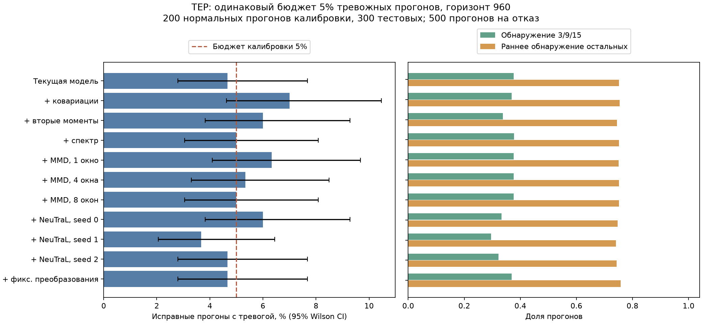
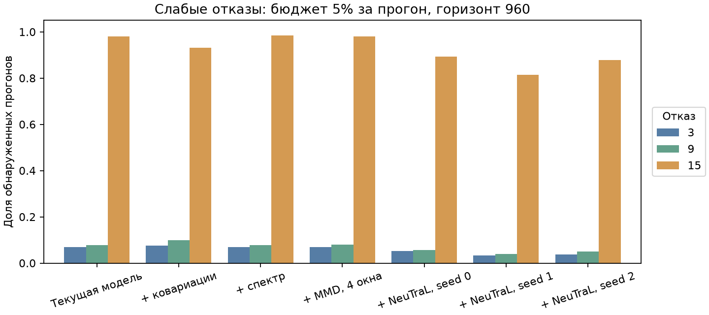

# Проверка идей Lacuna на Tennessee Eastman

Дата: 30 октября 2026 года.

Статистические ветви и небольшой NeuTraL AD реализованы в проекте. Это адаптации принципов MSCRED, TFAD и kernel change detection; полные нейросетевые архитектуры MSCRED/TFAD/LNT не воспроизводились.

## Результат проверки

Ни одна новая ветвь в проверенных конфигурациях не дала убедительного общего выигрыша над текущей сборкой. Спектр и MMD практически повторяют её, зависимости перераспределяют ошибки между слабыми отказами, NeuTraL AD ухудшает результат во всех трёх запусках. Рабочую модель по этим данным заменять оснований нет.

Калибровка по целым прогонам позволяет выбрать другую рабочую точку: на одних и тех же 300 нормальных прогонах доля тревог падает с 30.7% до 4.7%. При этом среднее обнаружение отказов 3/9/15 падает с 87.6% до 37.6%. Для остальных 17 отказов обнаружение остаётся 100%, а раннее обнаружение меняется с 77.6% до 75.2%. Это обмен чувствительности на меньшую нагрузку тревог.

При бюджете 5% добавление спектра даёт +0.13 процентного пункта среднего обнаружения 3/9/15, MMD с четырьмя окнами — +0.07 п.п. Парный bootstrap по 500 simulationRun совместно для трёх отказов не выделяет эти изменения как надёжный выигрыш: интервалы включают ноль. Все интервалы и разности сохранены в paired_hard_differences.csv; они исследовательские, без поправки на выбор среди нескольких кандидатов.

Общий вход: 52 канала, окно 24, шаг 8. Обучение на 400 исправных прогонах; 100 отдельных прогонов из нормального обучающего файла — для порогов до 500 отсчётов. Для горизонта 960 заранее случайно выделены 200 нормальных прогонов из тестового файла для калибровки и 300 для оценки. Все 20 отказов проверены на 500 прогонах каждый. Список прогонов и параметры записаны в manifest.json до оценки отказов.

Каждая новая ветвь проверена отдельно и в максимуме с текущими CVA, моментами и медленными признаками. Все оценки дополнительно сглажены EWMA с весом 0.2. MMD проверен с историей 1/4/8 окон; NeuTraL AD — с seed 0/1/2 и контролем с фиксированными случайными преобразованиями. Нейросети обучались фиксированные 20 эпох без выбора по отказам.

## Основное сравнение

Одинаковый номинальный бюджет 5% за прогон и горизонт 960. Реализованные тестовые доли тревог могут различаться: их интервалы показаны на рисунке. Задержка — медиана по обнаруженным прогонам внутри отказа, затем медиана по трём отказам; пропуски отражает отдельная колонка обнаружения.

| Модель | Тревожные нормальные прогоны | Раннее обнаружение остальных | Обнаружение 3/9/15 | AUROC 3/9/15 | Задержка 3/9/15, мин |
| --- | --- | --- | --- | --- | --- |
| Текущая модель | 0.047 | 0.752 | 0.376 | 0.818 | 1056 |
| + ковариации | 0.070 | 0.754 | 0.369 | 0.811 | 1200 |
| + вторые моменты | 0.060 | 0.744 | 0.338 | 0.812 | 1200 |
| + спектр | 0.050 | 0.752 | 0.377 | 0.811 | 1056 |
| + MMD, 1 окно | 0.063 | 0.751 | 0.376 | 0.812 | 1032 |
| + MMD, 4 окна | 0.053 | 0.751 | 0.377 | 0.810 | 1044 |
| + MMD, 8 окон | 0.050 | 0.752 | 0.376 | 0.810 | 1056 |
| + NeuTraL, seed 0 | 0.060 | 0.747 | 0.333 | 0.743 | 1296 |
| + NeuTraL, seed 1 | 0.037 | 0.742 | 0.296 | 0.758 | 1440 |
| + NeuTraL, seed 2 | 0.047 | 0.744 | 0.322 | 0.763 | 1248 |
| + фикс. преобразования | 0.047 | 0.758 | 0.369 | 0.753 | 1020 |





## Что даёт сама калибровка

Ниже прежний и новые пороги проверены на одних и тех же 300 нормальных прогонах. Отказы во всех трёх строках одинаковые: 500 прогонов на каждый тип, горизонт 960.

| protocol | n_normal_test_runs | false_alarm_run_rate | easy_detection | hard_detection | hard_median_delay_minutes |
| --- | --- | --- | --- | --- | --- |
| window_1pct_960 | 300 | 0.3067 | 1.0 | 0.876 | 768.0 |
| run_5pct_960 | 300 | 0.0467 | 1.0 | 0.376 | 1056.0 |
| run_10pct_960 | 300 | 0.1333 | 1.0 | 0.524 | 1152.0 |

Полная таблица протоколов с разными горизонтами:

| protocol | n_calibration_runs | n_normal_test_runs | false_alarm_run_rate | easy_detection | easy_early_detection | hard_detection | hard_median_delay_minutes |
| --- | --- | --- | --- | --- | --- | --- | --- |
| window_1pct_960 | 100 | 500 | 0.302 | 1.0 | 0.7761 | 0.876 | 768.0 |
| run_5pct_500 | 100 | 500 | 0.078 | 1.0 | 0.7702 | 0.4793 | 504.0 |
| run_10pct_500 | 100 | 500 | 0.106 | 1.0 | 0.7732 | 0.5533 | 528.0 |
| run_5pct_960 | 200 | 300 | 0.0467 | 1.0 | 0.7519 | 0.376 | 1056.0 |
| run_10pct_960 | 200 | 300 | 0.1333 | 1.0 | 0.7644 | 0.524 | 1152.0 |

Протокол window_1pct_960 воспроизводит прежний оконный порог на всех 500 нормальных тестовых прогонах. Протоколы run_*_500 используют 100 коротких нормальных калибровочных прогонов и первые 500 отсчётов всех 500 нормальных тестовых прогонов. Протоколы run_*_960 используют отдельные 200/300 длинных нормальных прогонов. Сравнение горизонтов не является чистым сравнением моделей: меняются время наблюдения и калибровочные данные.

## Ограничения интерпретации

Контроль по прогонам — маргинальный split-conformal результат при обменности нормальных траекторий и заранее зафиксированной модели. Это не обещание точного эмпирического FPR на одном наборе и не гарантия при произвольном изменении режима. Масштабы ветвей по-прежнему считаются на нормальном обучении; финальные пороги — на отдельных прогонах.

В существующем протоколе исключены окна, пересекающие введение отказа; минимальная засчитываемая задержка остаётся 72 минуты. История MMD и EWMA работает на той же сетке окон. Более длинные спектральные окна 48/96 и отдельный оперативный протокол здесь не вводились. Это первая проверка пяти идей с фиксированными настройками, а не исчерпывающий поиск архитектур и гиперпараметров.

Тест TEP уже использовался в предыдущих исследованиях проекта. Выбор кандидата по этим результатам исследовательский; независимое подтверждение требует ранее не использованных прогонов или новых симуляций. Для доверительных интервалов FPR единицей наблюдения служит целый прогон. Высокий AUROC сам по себе не означает хорошее обнаружение при малом бюджете тревог.

## Воспроизведение

```powershell
poetry install
uv pip install --python .venv/Scripts/python.exe -r requirements-neural.txt
.venv/Scripts/python.exe scripts/run_lacuna_experiments.py
.venv/Scripts/python.exe scripts/summarize_lacuna_experiments.py
```

CPU PyTorch вынесен в отдельный requirements-neural.txt, чтобы не менять основной Poetry lock. Версии библиотек записаны в manifest.json. summary.csv содержит все модели и пять протоколов, per_fault.csv — результаты каждого отказа, timing.csv — ориентировочные накопленные времена прерванного/продолженного расчёта, neural_training.json — ход обучения. Локальные веса, оценки и таблицы по отдельным прогонам лежат в игнорируемом data/processed/lacuna_2026-10-30/.

Ссылки и исходные гипотезы: [исследовательская заметка](../../docs/research/lacuna_ideas_2026-10-30.md).
